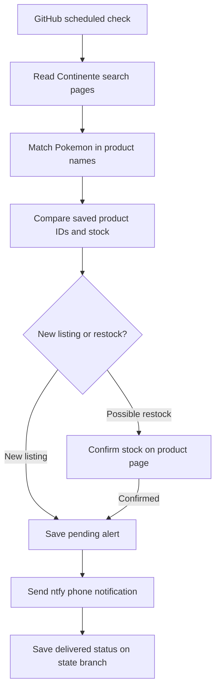

# Continente Pokémon alerts

Check Continente for new Pokémon products and confirmed restocks, then send
phone push notifications through ntfy.



The schedule requests a check every five minutes. GitHub may delay or skip
scheduled runs, so the interval is not guaranteed. Standard GitHub-hosted
runners are free for public repositories; this workflow skips private repos.

Set the repository Actions secret `NTFY_TOPIC` to the destination topic.
Keep notification settings out of source files. The `monitor-state` branch
stores public product history and the durable alert queue between runs.

Matching ignores case and accents: both “Pokémon” and “Pokemon” match. New
listings include their stock status. Restocks require a known unavailable
product to become available and confirmation from its product page. The
original Delta Reign booster is also checked directly every run. Store and
delivery-address availability can differ from the anonymous storefront.

Run the checks locally with Python 3.12:

```sh
python -m unittest discover -s tests -v
```

See [README.txt](README.txt) for setup, state persistence and operating details.
